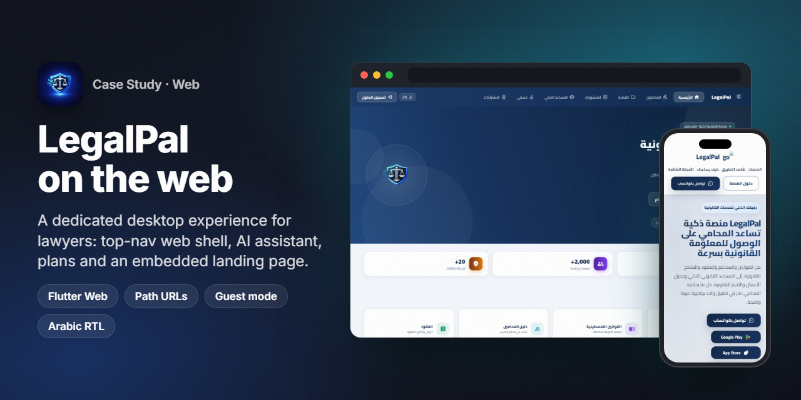
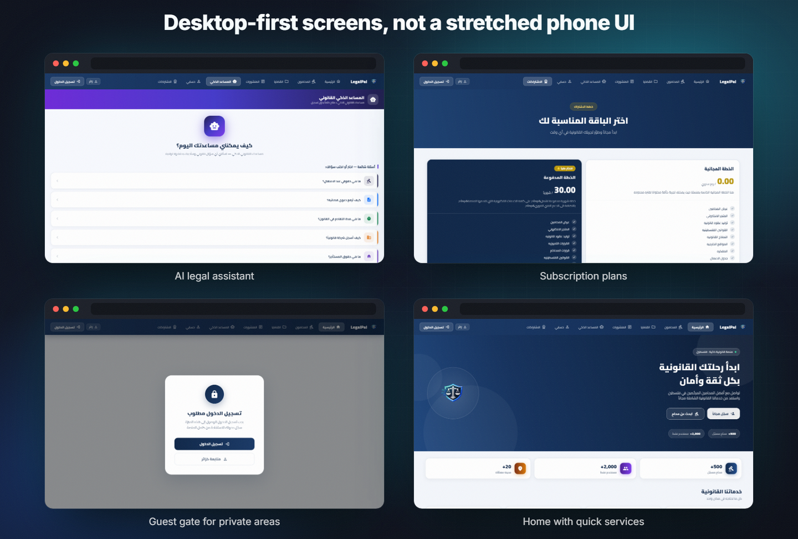
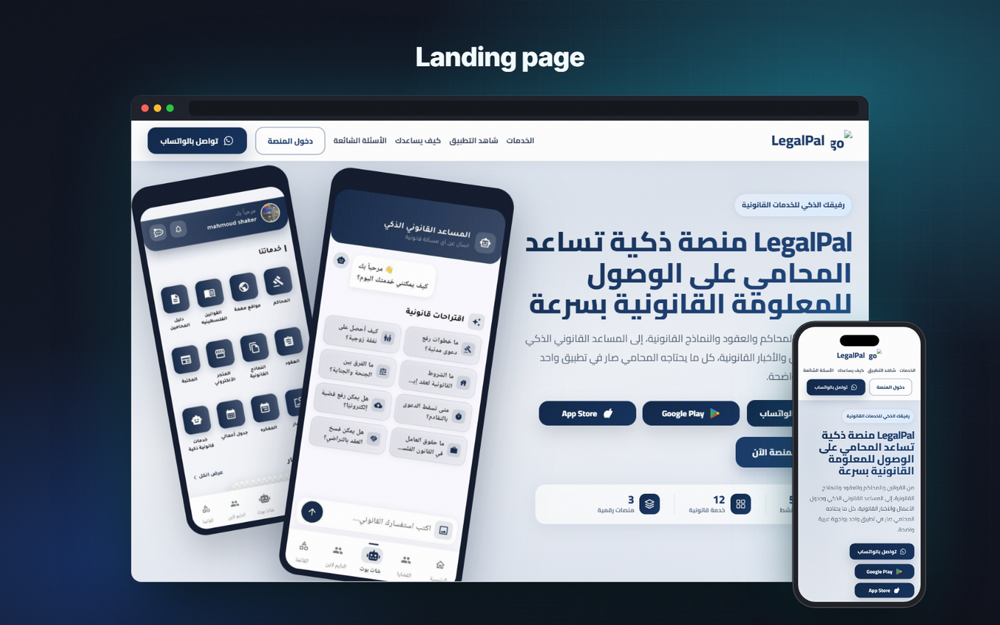
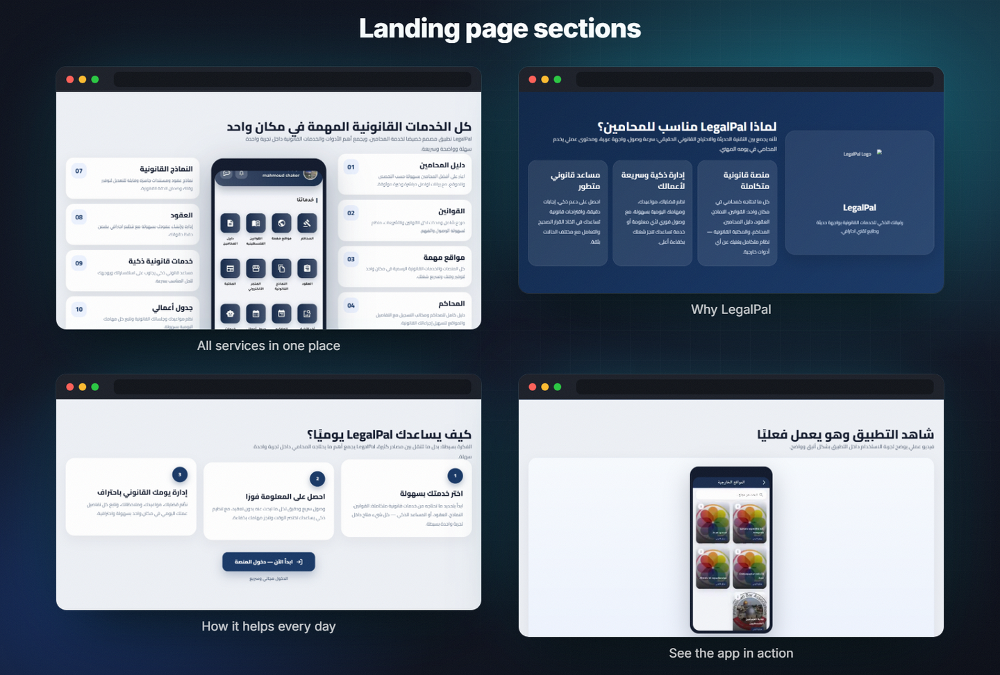
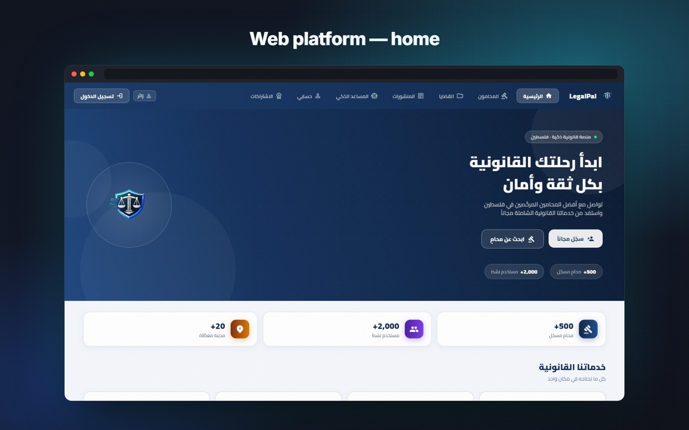
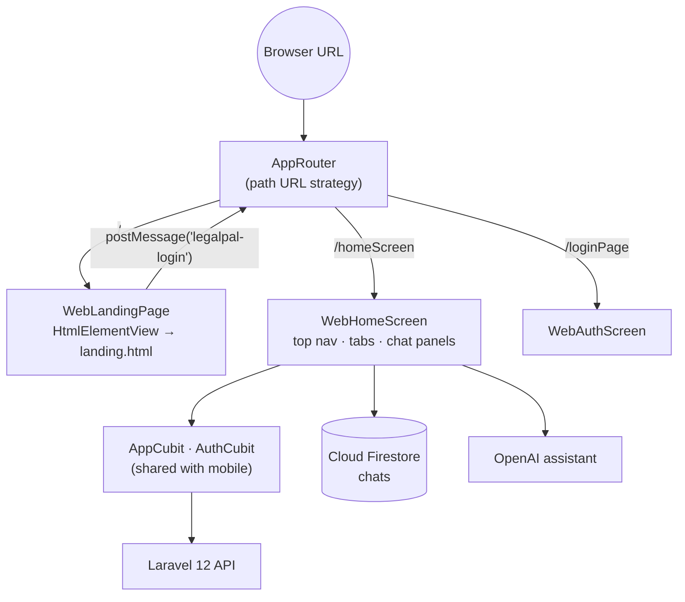

<h1 align="center">LegalPal — Web</h1>

<b>A desktop-first web platform for lawyers, built in Flutter, with a landing page embedded in the app.</b>

  
  
  
  
  
  

> ℹ️ This is a case study. The source code belongs to the client and is not included.

## Overview

[LegalPal](https://github.com/ANaSHaker/legalpal-app-case-study) is a legal platform for lawyers in Palestine. It is live on Google Play and the App Store. Lawyers also work at a desk, so the client wanted LegalPal in the browser too: with a big screen, a keyboard and side-by-side chats.

I built the **web version in the same Flutter codebase**. On mobile, Flutter shows the phone UI with bottom navigation. On the web it switches to a dedicated **`WebHomeScreen`**: a top-navigation desktop application with its own tab system, layouts and chat panels. The marketing **landing page** is part of the same build. Flutter embeds it as the web entry point, and it hands control back to the app when the visitor clicks "Enter the platform".

## The challenge

- **A phone UI does not scale up.** Bottom tabs and full-screen pages waste a 1440 px monitor. Lawyers expect a top navigation bar, cards in grids and several things on screen at once.
- **Marketing and product in one deploy.** The client wanted one URL. Visitors land on a sales page, and one click takes them into the real app, already signed in if they have a session.
- **Guests first.** Most web visitors have no account yet. They must be able to browse, see the plans and talk to the assistant before registering.
- **Mobile-only plugins.** Maps, push notifications, Crashlytics and local storage tricks don't all exist on the web, and the web build must not crash because of them.

## Highlights

**🖥️ Desktop web platform (`WebHomeScreen`)**
- A top navigation bar with nine areas: home, lawyers, cases, posts, AI assistant, chats, support, account and subscriptions. The bar scrolls on smaller screens.
- A hero home page with quick-service cards (contracts, lawyer directory, Palestinian laws, important websites and more).
- **AI assistant tab:** a full-width chat with suggested questions and image upload.
- **Messenger-style chat panels** that float at the bottom of the screen, one panel per conversation, so a lawyer can keep talking while browsing.
- Web versions of the notifications and subscription screens. The plans page compares free and paid plans side by side.
- A guest label and login button in the nav bar. Private areas, such as cases, show a "sign-in required" card with **Sign in** or **Continue as guest**.

**🌐 Embedded landing page**
- A standalone `landing.html` (Cairo font, RTL) with the following sections:
  - hero
  - services
  - why LegalPal
  - an app preview
  - how it works
  - FAQ
  - a contact form, WhatsApp, email and store badges
- Flutter mounts it in an `HtmlElementView` iframe as the web start route. The page sends a `postMessage('legalpal-login')`. Flutter listens and routes the visitor into the app as a guest, or to sign-in if a session already exists.

**🔗 Web plumbing**
- Path URL strategy (`usePathUrlStrategy`) gives clean, shareable URLs. The browser URL overrides the initial route, so deep links open the right screen.
- A dedicated web auth screen (sign-in, register, reset) designed for wide screens.
- `kIsWeb` guards around Crashlytics, Analytics observers, push notifications and Mapbox.

## Screens

AI assistant, subscription plans, guest gate on private areas and the home page.

Landing page on desktop and phone.

> These are real captures of the LegalPal Flutter web build and its landing page, rendered with headless Chrome at 1440 × 900 and 390 × 844. The landing's logo image did not load in the local copy, which is why a small placeholder appears next to the wordmark.

## Signature feature: a real desktop app, not a stretched phone

- `WebHomeScreen` is a separate presentation layer, not a responsive tweak. It has its own tab enum, navigation bar, page layouts and chat-panel stack.
- It reuses all the business logic. The same `AppCubit`, `AuthCubit`, `DioHelper` and models drive both the mobile and the web UI, so a fix in the data layer ships everywhere.
- HTML content from the backend (descriptions, news) is cleaned of tags and entities before it is displayed, so cards stay tidy.
- Chats use the same Cloud Firestore streams as mobile. Each conversation becomes a floating panel, positioned independently and collapsible.

## Architecture & stack

| Layer | Technology |
|---|---|
| Web UI | Flutter web (CanvasKit), `WebHomeScreen`, `WebAuthScreen`, web-specific notification and subscription screens |
| Landing | Static HTML/CSS (`landing.html`) inside an iframe via `HtmlElementView` and `platformViewRegistry` |
| Interop | `dart:html` window messages (`postMessage`), conditional imports with stubs for mobile |
| Routing | `AppRouter` + `usePathUrlStrategy()` |
| Shared | Bloc/Cubit, Dio, Hive/SharedPreferences, Cloud Firestore, OpenAI service |

## Engineering notes

- **Conditional imports keep mobile clean.** `web_landing_page.dart` and `web_auth_screen.dart` have `_stub` twins selected with `if (dart.library.io)`. The Android and iOS builds never import `dart:html` or `dart:ui_web`.
- **Iframe ↔ Flutter handshake.** The view factory is registered once (with a static guard against double registration on hot restart), and the message subscription is cancelled in `dispose`. A logged-in visitor goes straight to the app, and a new visitor enters as a guest.
- **Guest mode on the web.** Guest handling differs per platform. On the web, guest status comes from the session rather than a stored flag, so protected tabs can show a friendly gate instead of an error.
- **Startup without mobile plugins.** Firebase Messaging, Crashlytics and the Analytics observer are initialised only when `!kIsWeb`. The web build starts fast and never fails on a missing plugin.

## Results

- The web platform and landing ship from the same Flutter project as the store apps: LegalPal on [Google Play](https://play.google.com/store/apps/details?id=com.legalapp.pal) (100+ installs) and the [App Store](https://apps.apple.com/sa/app/legalpal/id6761775155).

## بالعربي

نسخة الويب من **LegalPal** مبنية من كود Flutter نفسه، لكن بواجهة مخصصة لسطح المكتب (`WebHomeScreen`).
فيها شريط تنقل علوي بتسعة أقسام، ومساعد ذكي بعرض الشاشة، ونوافذ محادثة عائمة مثل ماسنجر، وصفحة باقات الاشتراك.
الصفحة التعريفية (Landing) مدمجة داخل التطبيق، وزر "دخول المنصة" ينقل الزائر مباشرة إلى التطبيق كزائر أو إلى حسابه.
روابط مباشرة لكل صفحة، ووضع زائر، واتجاه عربي كامل من اليمين لليسار.

## Links

- ▶️ [Google Play](https://play.google.com/store/apps/details?id=com.legalapp.pal)
- 🍎 [App Store](https://apps.apple.com/sa/app/legalpal/id6761775155)
- 📱 Mobile case study: [legalpal-app-case-study](https://github.com/ANaSHaker/legalpal-app-case-study)

---
<h3 align="center">Built by Mahmoud Shaker — Senior Flutter Engineer</h3>

  
  
  
  
  
  
  

